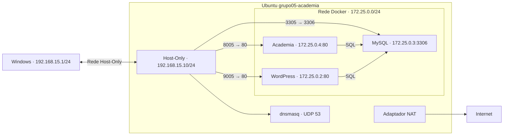

# Grupo 05 Academia

Projeto da disciplina de Redes de Computadores. Um cliente Windows acessa dois serviços web em uma VM Ubuntu no VirtualBox. A aplicação em PHP cadastra e lista alunos e planos. O blog WordPress publica informações sobre a academia. Os dois serviços usam a mesma instância MySQL, cada um com sua própria base de dados.

**Integrantes** — Felipe Gabriel, Yasmin Carvalho e Vitória Gabrielly.

## Topologia



| Serviço | Acesso a partir do Windows |
| --- | --- |
| Aplicação Academia | `http://academia.local:8005/` |
| Blog WordPress | `http://blog.academia.local:9005/` |
| MySQL | `academia.local:3305` |

## Montar o ambiente

1. Crie no VirtualBox uma VM Ubuntu com Docker Engine e o plugin Docker Compose. Configure o primeiro adaptador da VM como **NAT** para a instalação e o download das imagens. Configure o segundo como **Host-Only**. Use `192.168.15.1/24` no adaptador virtual do Windows e `192.168.15.10/24` na interface Host-Only do Ubuntu, identificada com `ip -br address`. Como os endereços são fixos, deixe o DHCP dessa rede desativado.
2. Na VM, instale `dnsmasq`. Em `/etc/dnsmasq.d/academia.conf`, configure o DNS para escutar no endereço da rede Host-Only.

   ```ini
   listen-address=192.168.15.10
   bind-interfaces
   host-record=academia.local,192.168.15.10
   host-record=blog.academia.local,192.168.15.10
   ```

   Valide a configuração e inicie o serviço.

   ```bash
   sudo dnsmasq --test
   sudo systemctl restart dnsmasq
   ```

3. No Windows, abra o PowerShell como administrador. Encaminhe as consultas para os dois nomes à VM e limpe o cache DNS. Execute `Add-DnsClientNrptRule` uma vez. Se a regra já existir, confira os domínios e o servidor em `Get-DnsClientNrptRule` antes de mudar a configuração.

   ```powershell
   Add-DnsClientNrptRule -DisplayName 'Grupo 05 Academia - DNS local' `
     -Namespace @('academia.local','blog.academia.local') -NameServers '192.168.15.10'
   Clear-DnsClientCache
   ```

4. Clone o repositório dentro da VM. Copie `.env.example` para `.env` e preencha as quatro senhas com valores diferentes de pelo menos 32 caracteres alfanuméricos.

   ```bash
   git clone https://github.com/felipegmsx/Projeto-Redes.git
   cd Projeto-Redes
   cp .env.example .env
   ```

5. Na mesma pasta, suba os serviços. Use `sudo` se a sua conta no Linux precisar de privilégios para executar o Docker. Os scripts de criação da base e concessão das permissões rodam na primeira inicialização do volume MySQL.

   ```bash
   docker compose up -d --build
   docker compose ps
   ```

6. No Windows, abra a aplicação e cadastre um aluno fictício. No primeiro acesso ao blog, conclua a instalação do WordPress pelo navegador. O plugin do projeto cria o post **Conheça os planos da academia** durante essa etapa.
7. No DBeaver, crie uma conexão do tipo MySQL com host `academia.local`, porta `3305`, usuário `demonstracao` e a senha `DEMO_DB_PASSWORD` do `.env`. Deixe o campo de banco vazio para consultar as duas bases. Nas propriedades do driver, defina `sslMode=REQUIRED`. Execute as [consultas de demonstração](docs/consultas-demonstracao.sql) para ver o aluno cadastrado, o post do blog e a cifra TLS usada pelo cliente.

## Demonstrar a conexão

1. No Wireshark do Windows, inicie a captura na placa virtual Host-Only. Use `Resolve-DnsName academia.local -Server 192.168.15.10 -Type A -DnsOnly -NoHostsFile` e repita para `blog.academia.local`. O DNS deve retornar `192.168.15.10` para os dois nomes.
2. No navegador, abra **F12 → Network/Rede**, marque **Preserve log** e envie o formulário. Abra a requisição `POST` e mostre os campos `aluno` e `plano` em **Payload**. A resposta `303` encaminha o navegador ao `GET` da lista atualizada. No WordPress, abra o `GET` do documento principal.
3. Compare as requisições do navegador com a captura do Wireshark. Localize os pacotes DNS, o handshake TCP, os cabeçalhos Ethernet, IPv4, TCP e HTTP e o corpo do formulário. Se necessário, use **Decode As** para decodificar `8005` e `9005` como HTTP. O filtro `dns or tcp.port == 8005 or tcp.port == 9005` ajuda a encontrar os fluxos.
4. O tráfego das aplicações ao MySQL circula na rede Docker da VM. Na VM, com `tcpdump` instalado, identifique a interface ligada ao contêiner MySQL e comece a captura.

   ```bash
   peer=$(sudo docker exec academia-mysql cat /sys/class/net/eth0/iflink)
   iface=$(ip -o link | awk -F': ' -v n="$peer" '$1==n {sub(/@.*/, "", $2); print $2}')
   printf 'Interface de captura: %s\n' "$iface"
   sudo tcpdump -i "$iface" -nn -s 0 -w /tmp/academia-mysql.pcap 'host 172.25.0.3 and tcp port 3306'
   ```

   Enquanto a captura estiver ativa, faça um novo cadastro e recarregue o blog. Encerre a captura com Ctrl+C e abra o arquivo no Wireshark. Compare a inclusão e a leitura de alunos com as consultas que o WordPress usa para montar a página.

## Arquivos do projeto

| Caminho | Conteúdo |
| --- | --- |
| `app/` | Formulário, listagem de alunos, CSS e imagem Docker do PHP |
| `wordpress/grupo05-academia.php` | Identificação e conteúdo inicial do blog |
| `mysql/` | Criação da tabela de alunos e permissões dos usuários MySQL |
| `docker-compose.yml` | Serviços, portas, rede interna e volumes de dados |
